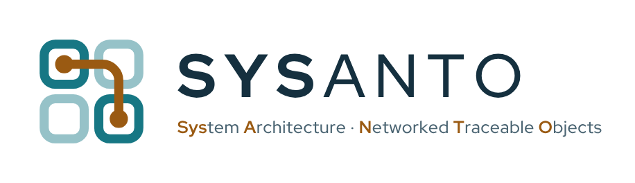

<p align="center"></p>

# SYSANTO

**System Architecture · Networked Traceable Objects**

SYSANTO ist ein schlankes MBSE-Werkzeug für Systemarchitekturen: Systemkatalog, Schnittstellen, Funktionsketten, Anforderungen und Diagramme in einem gemeinsamen Modell. Läuft lokal, ohne Cloud und ohne Telemetrie.

SYSANTO is a lean MBSE tool for system architectures: system catalog, interfaces, functional chains, requirements and diagrams in one shared model. Runs locally, no cloud, no telemetry.

## Download

Die Programmpakete liegen unter **[Releases](../../releases)**. / Packages are attached to the **[Releases](../../releases)**.

| Plattform / Platform | Datei / File |
|---|---|
| Windows 10/11 x64 | `SYSANTO-<version>-Windows-x64.zip` |
| Linux x64 (glibc 2.35+) | `SYSANTO-<version>-Linux-x64.tar.gz` |

Jede Datei hat eine SHA-256-Prüfsumme in `SHA256SUMS.txt`. / Each file is listed with its SHA-256 checksum in `SHA256SUMS.txt`.

### Windows

1. ZIP entpacken. / Unzip.
2. `Install.cmd` ausführen. Das legt SYSANTO für den aktuellen Benutzer an, erstellt Desktop- und Startmenü-Verknüpfung. Keine Administratorrechte nötig. / Run `Install.cmd` (per-user, no admin rights).
3. Exporte (PNG/SVG/PDF) nutzen den installierten Microsoft Edge oder Google Chrome. / Exports use the installed Edge or Chrome.

Projektdaten liegen unter `%LOCALAPPDATA%\SystemChainStudio\data` und bleiben bei Updates erhalten. / Project data stays in `%LOCALAPPDATA%\SystemChainStudio\data` across updates.

### Linux

```sh
tar xzf SYSANTO-<version>-Linux-x64.tar.gz
./SYSANTO-<version>/SystemChainStudio
```

Projektdaten / Project data: `~/.local/share/SystemChainStudio/data`. Für Exporte wird Google Chrome oder Chromium benötigt. / Exports need Google Chrome or Chromium.

## Basic und Pro

SYSANTO Basic ist kostenlos und braucht keine Lizenz. Pro-Funktionen werden mit einer Lizenz freigeschaltet; Pro-Lizenzen sind in Vorbereitung. Projekte bleiben auch ohne Pro-Lizenz immer lesbar, bearbeitbar und exportierbar.

SYSANTO Basic is free and needs no licence. Pro features are unlocked with a licence; Pro licences are coming soon. Projects always stay readable, editable and exportable without Pro.

## Rechtliches / Legal

- Lizenzhinweise aller enthaltenen Komponenten Dritter liegen im Programmpaket im Ordner `licenses/` und in SYSANTO unter *Open Source & Lizenzen*. / Third-party licence notices ship in the package folder `licenses/`.
- Dieses Repository enthält keinen Quelltext. / This repository contains no source code.

© 2026 Daniel Splett. Alle Rechte vorbehalten. / All rights reserved.
