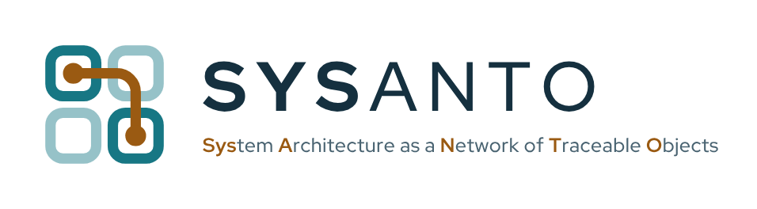

<p align="center"></p>

# SYSANTO

**System Architecture as a Network of Traceable Objects**

SYSANTO ist ein schlankes MBSE-Werkzeug für Systemarchitekturen: Systemkatalog, Schnittstellen, Wirkketten, Anforderungen und Diagramme in einem gemeinsamen Modell. Läuft lokal, ohne Cloud und ohne Telemetrie.

SYSANTO is a lean MBSE tool for system architectures: system catalog, interfaces, effect chains, requirements and diagrams in one shared model. Runs locally, no cloud, no telemetry.

## Download

Die Programmpakete liegen unter **[Releases](../../releases)**. / Packages are attached to the **[Releases](../../releases)**.

| Plattform / Platform | Datei / File |
|---|---|
| Windows 10/11 x64 (Setup) | `SYSANTO-<version>-Windows-x64-Setup.exe` |
| Windows 10/11 x64 (ZIP) | `SYSANTO-<version>-Windows-x64.zip` |
| Linux x64 (glibc 2.35+) | `SYSANTO-<version>-Linux-x64.tar.gz` |

Jede Datei hat eine SHA-256-Prüfsumme in `SHA256SUMS.txt`. / Each file is listed with its SHA-256 checksum in `SHA256SUMS.txt`.

### Windows

**Setup (empfohlen / recommended):** `SYSANTO-<version>-Windows-x64-Setup.exe` ausführen. Installiert für den aktuellen Benutzer ohne Administratorrechte, legt Desktop- und Startmenü-Verknüpfung an und trägt SYSANTO unter *Installierte Apps* ein; dort lässt es sich auch deinstallieren. / Run the Setup.exe: per-user, no admin rights, shortcuts, listed under *Installed apps* for uninstalling.

**ZIP:** entpacken und `Install.cmd` ausführen; `Uninstall.cmd` entfernt SYSANTO wieder. / Unzip and run `Install.cmd`; `Uninstall.cmd` removes SYSANTO.

Beide Wege legen dieselbe Installation an; ein Update geht mit Setup oder ZIP der neuen Version. Exporte (PNG/SVG/PDF) nutzen den installierten Microsoft Edge oder Google Chrome. / Both create the same installation; update with the Setup or ZIP of the new version. Exports use the installed Edge or Chrome.

Projektdaten liegen unter `%LOCALAPPDATA%\SYSANTO\data` und bleiben bei Updates und beim Deinstallieren erhalten, außer das Löschen wird ausdrücklich gewählt. / Project data stays in `%LOCALAPPDATA%\SYSANTO\data` across updates and uninstalling unless you choose to delete it.

Softwareverteilung / Silent install: `SYSANTO-<version>-Windows-x64-Setup.exe /VERYSILENT /SUPPRESSMSGBOXES /NORESTART` (optional `/NOSHORTCUT=1`).

Das Programm ist noch nicht signiert; Windows SmartScreen fragt deshalb einmal nach („Weitere Informationen“ → „Trotzdem ausführen“). / The program is not signed yet; SmartScreen asks once ("More info" → "Run anyway").

### Linux

```sh
tar xzf SYSANTO-<version>-Linux-x64.tar.gz
./SYSANTO-<version>/sysanto
```

Projektdaten / Project data: `~/.local/share/sysanto/data`. Für Exporte wird Google Chrome oder Chromium benötigt. / Exports need Google Chrome or Chromium.

## Basic und Pro

SYSANTO Basic ist kostenlos und braucht keine Lizenz. Pro-Funktionen werden mit einer Lizenz freigeschaltet; Pro-Lizenzen sind in Vorbereitung. Projekte bleiben auch ohne Pro-Lizenz immer lesbar, bearbeitbar und exportierbar.

SYSANTO Basic is free and needs no licence. Pro features are unlocked with a licence; Pro licences are coming soon. Projects always stay readable, editable and exportable without Pro.

## Rechtliches / Legal

- Für die Nutzung gelten die Lizenzbedingungen: [EULA.md](EULA.md) (Deutsch, maßgeblich), [EULA.en.md](EULA.en.md), [EULA.fr.md](EULA.fr.md). Sie liegen auch im Programmpaket und stehen in SYSANTO unter *Open Source & Lizenzen*. / Use is governed by the licence terms: [EULA.en.md](EULA.en.md) (the German version prevails).
- Anbieter / Provider: Daniel Splett · kontakt@sysanto.de · Impressum / Legal notice: www.sysanto.de
- Lizenzhinweise aller enthaltenen Komponenten Dritter liegen im Programmpaket im Ordner `licenses/` und in SYSANTO unter *Open Source & Lizenzen*. / Third-party licence notices ship in the package folder `licenses/`.
- Dieses Repository enthält keinen Quelltext. / This repository contains no source code.

© 2026 Daniel Splett. Alle Rechte vorbehalten. / All rights reserved.
